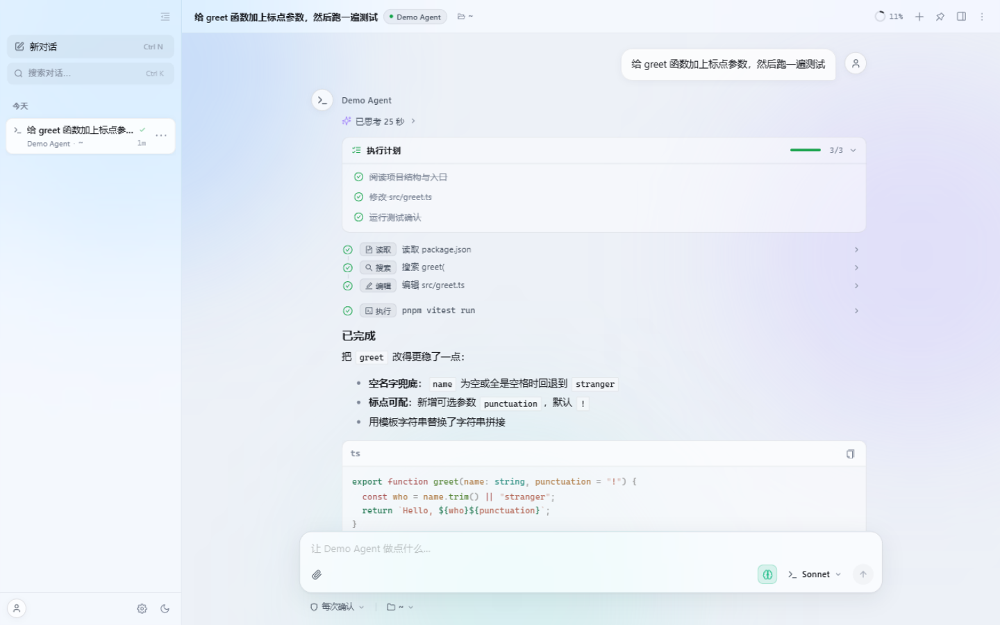
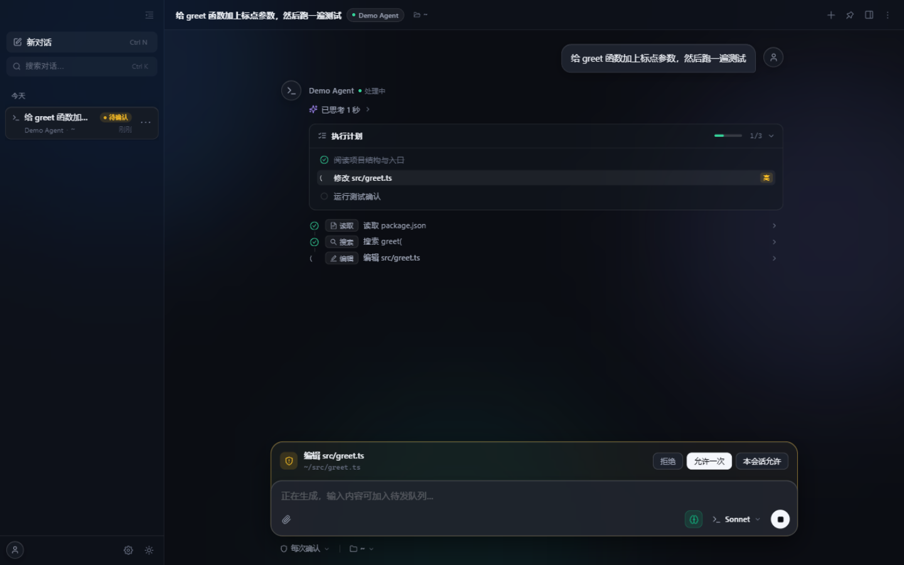
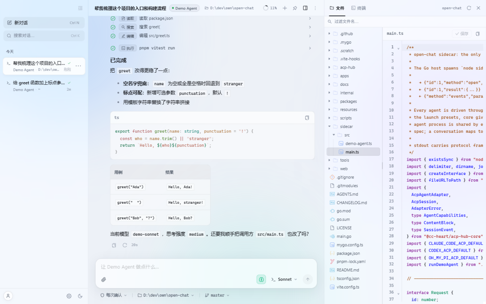

<div align="center">
  
  <h1>open-chat</h1>
  <p><strong>One window for every coding agent on your machine.</strong></p>
  <p>A local-first desktop &amp; web workbench that speaks <a href="https://agentclientprotocol.com">ACP</a> natively —<br/>Claude Code, Codex, CodeBuddy, Qoder, Pi, Oh My Pi and any custom agent.</p>
  <p>
    <a href="https://github.com/CarlOpenLab/open-chat/releases/latest"></a>
    <a href="LICENSE"></a>
    
    <a href="https://carlopenlab.github.io/open-chat/"></a>
  </p>
</div>

---

**open-chat** collects the coding agents you already have installed into one restrained, fast workspace. It talks to them over the [Agent Client Protocol](https://agentclientprotocol.com) (via [acp-hub](https://github.com/CarlOpenLab/acp-hub)), so a session is the same whether the agent is Claude Code, Codex, CodeBuddy, Qoder, Pi, Oh My Pi or a custom command-line agent you wired up yourself. Run it as a native desktop app — or turn the same binary into a LAN web server with one command.

<p align="center">
  
</p>

## Highlights

- **Multi-agent, one entry point** — connect Claude Code, Codex, CodeBuddy, Qoder, Pi, Oh My Pi or any custom ACP agent; every session is tied to a working directory, with slash commands, model & thinking-level pickers and image attachments built in.
- **Permission approvals as first-class citizens** — tool authorization floats right above the composer: Allow on the right, Deny on the left, hard to mis-hit. Switch between confirm-each / auto-approve / full access at any time; the mode syncs live to the agent via ACP.
- **A visible, resumable turn** — thinking, execution plans, tool calls, diffs and terminal output stream into one transcript. Conversations persist locally and resume via `session/load`; if a resume fails it says so instead of pretending.
- **Zero environment fuss** — the Node sidecar is bundled into the installer and the frontend is embedded in the binary. PATH is read from your login shell at launch, so `node`, `claude` and `codex` are found even when launched from the Dock.
- **Workspace panel** — file tree, built-in terminal and a CodeMirror 6 editor next to the conversation, with Catppuccin file icons and `⌘S` / `Ctrl+S` to save.
- **Desktop & web from one binary** — `open-chat serve` exposes the same UI over HTTP + SSE with a one-time token, so tablets and other machines on your LAN pick up where you left off.

<p align="center">
  &nbsp;
  
</p>

## Quick start

Grab an installer from [GitHub Releases](https://github.com/CarlOpenLab/open-chat/releases/latest) — macOS `.dmg`, Windows setup `.exe`, or Linux `.deb` / `.rpm` / `.tar.gz`. Installed builds auto-update in the background: new versions are checked once a day, verified with an Ed25519 signature, and swapped in place on restart.

Prefer the browser? The same UI works without a window:

```bash
open-chat serve                     # 127.0.0.1:4310, prints a tokenized URL
open-chat serve -addr 0.0.0.0:4310 -token xxx
open-chat serve -no-auth            # localhost / trusted LAN only
```

In serve mode every Host API method maps to `POST /api/call/<Method>`, and pushes ride a `GET /api/push` SSE stream — no IPC, so the page code never forks (`web/src/api.ts` branches once, via `isMyGo()`).

## How it works

Go owns the desktop; Node owns the protocol — the ACP ecosystem already lives in Node, so the sidecar is compiled to a single `.mjs` and embedded with `go:embed`. At runtime it lands one file in a cache directory; users never run `pnpm install`. Between the two layers there is exactly one protocol: NDJSON.

```
┌──────────────────────────────────────────────────────────┐
│  Go host (mygo)                                          │
│   · conversation persistence (index.json + per-id files) │
│   · login-shell environment detection (PATH / API keys)  │
│   · Host API ⇄ page; HTTP + SSE in serve mode            │
│   · manages the Node process below                       │
│        │ NDJSON over stdio                               │
│        ▼                                                 │
│  sidecar (Node, bundled, embedded in the binary)         │
│   · @cc-heart/acp-hub-core: ACP handshake, event         │
│     translation, permission bridging                     │
│   · one child process per agent, shared by conversations │
│        │ ACP over stdio                                  │
│        ▼                                                 │
│  Claude Code / Codex / CodeBuddy / Qoder / Pi /          │
│  Oh My Pi / any custom ACP agent                         │
└──────────────────────────────────────────────────────────┘
```

```jsonc
{"id":1,"method":"open","params":{"key":"…","agent":{…},"cwd":"…"}}
{"id":1,"result":{…}}
{"method":"events","params":{"key":"…","events":[…]}}   // no id = notification
```

## Configuration & data

`~/.config/open-chat/settings.json` holds theme, send key, auto-approval, default agent, recent folders, node path, agent overrides (command / args / env) and custom agents — the Settings UI edits exactly that file. Conversation records live beside it in `index.json` and `conversations/`, written atomically with streaming noise folded (adjacent deltas merged, `tool_call_update` folded into `tool_call`, plan overwrites, permission results marked).

## Development

```bash
pnpm install
pnpm build:sidecar     # bundle the sidecar into internal/sidecar/dist
pnpm dev               # mygo dev: window + vite (port 5173)

# browser-only UI development:
pnpm dev:web           # then in another terminal: open-chat serve -no-auth
```

```bash
pnpm build             # mygo build: installers under build/<os>-<arch>/
go test ./...          # host flow — really spawns node + sidecar
```

| Path | What's inside |
| --- | --- |
| `main.go` | entry: `open-chat` (desktop) / `open-chat serve` (web) |
| `internal/host/` | sessions, persistence, sidecar process management, Host API, HTTP service |
| `sidecar/src/main.ts` | acp-hub host: open / prompt / cancel / permission / setMode / setConfig |
| `web/src/` | Vue frontend (antdv-next + @antdv-next/x) |
| `site/` | landing page, deployed to GitHub Pages |
| `internal/webdist/` | embedded frontend build |

## Releasing

Pushing a `vX.Y.Z` tag builds macOS, Windows and Linux artifacts via GitHub Actions, publishes the Release, and signed builds pick up the update automatically. Key management, macOS signing and the release checklist live in [docs/releasing.md](docs/releasing.md).

## License

[MIT](LICENSE) © 2026 CarlOpenLab
