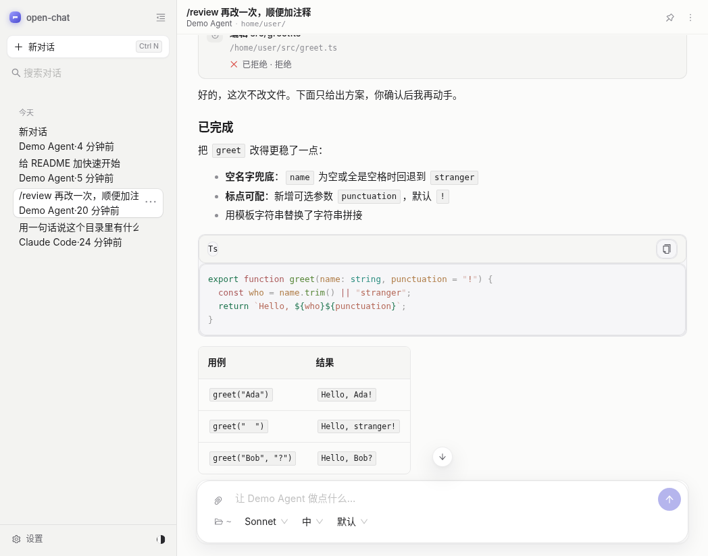
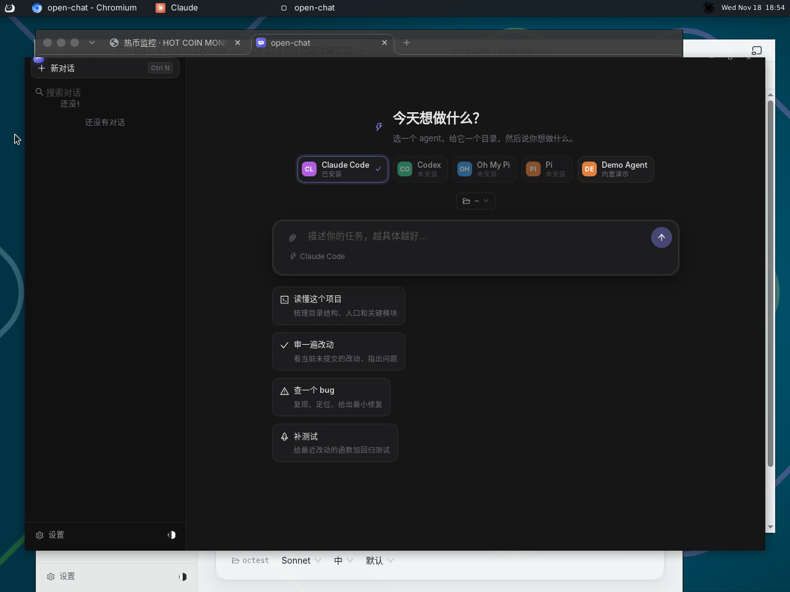

<div align="center">
  
  <h1>open-chat</h1>
  <p>把本机的 Coding Agent 收进同一个窗口 — 基于 Go (mygo) + Vue + ACP 的本地桌面与网页工作台</p>
</div>

---

**open-chat** 通过原生 [ACP（Agent Client Protocol）](https://agentclientprotocol.com) 与 [acp-hub](https://github.com/CarlOpenLab/acp-hub)，将你本机安装的 **Claude Code**、**Codex**、**pi**、**omp** 以及任意自定义 ACP Agent 统一收进一个轻量、克制的桌面工作台。支持以独立桌面窗口运行，也支持一行命令启动为内网/本机 Web 服务。

<p align="center">
  
</p>
<p align="center">
  
</p>

## 核心特性

- **多 Agent 统一入口**：通过 ACP 协议直连 Claude Code、Codex、pi、omp 或自定义命令行 Agent，一个窗口管理所有会话与工作目录。
- **一等公民权限审批与计划视图**：工具调用权限请求直接浮在消息流内（允许在右、拒绝在左，降低误触），支持推理过程折叠、代码 Diff 预览与执行计划卡片。
- **可靠的会话持久化与续接**：会话记录按对话落盘到本地 `index.json` 与 `conversations/`，重开走 `session/load` 恢复上下文；无法续接时明确提示，不静默丢状态。
- **零环境折腾的单文件打包**：Go 宿主内嵌单文件打包的 Node sidecar 与前端构建产物，桌面端启动自动读取登录 Shell 环境变量，从 Dock 启动也能找到 `node` / `claude` / `codex`。
- **桌面 / 网页双模式共享同一套 UI**：同一份二进制既可作为原生桌面应用运行，也可通过 `open-chat serve` 提供 HTTP + SSE 远程访问。

## 架构设计

```
┌──────────────────────────────────────────────────────────┐
│  Go 宿主（mygo）                                          │
│   · 会话与记录落盘（index.json + conversations/<id>.json） │
│   · 登录 shell 环境探测（PATH / API key）                  │
│   · mygo.Bind 的 Host API ⇄ 页面；serve 模式下换 HTTP+SSE   │
│   · 管理下面这个 Node 进程                                │
│        │ NDJSON over stdio                               │
│        ▼                                                 │
│  sidecar（Node，打包成单文件，嵌在二进制里）                │
│   · @cc-heart/acp-hub-core 负责 ACP 握手/事件翻译/权限桥接  │
│   · 每个 agent 一个子进程，多个对话共享同一个连接            │
│        │ ACP over stdio                                  │
│        ▼                                                 │
│  Claude Code / Codex / pi / omp / 任意自定义 ACP agent     │
└──────────────────────────────────────────────────────────┘
```

## 为什么分两层

Go 负责桌面该管的事（窗口、目录、对话框、持久化、环境变量），Node 负责 ACP——因为 acp-hub 是 TypeScript 库，而 agent 生态（`npx codex-acp` 之类）本来就在 Node 里。sidecar 编译成单个 `.mjs` 用 `go:embed` 打进二进制，运行时只在缓存目录里落一个文件，用户不需要 `pnpm install`。

宿主和 sidecar 之间只有一种协议：NDJSON。

```jsonc
{"id":1,"method":"open","params":{"key":"…","agent":{…},"cwd":"…"}}
{"id":1,"result":{…}}
{"method":"events","params":{"key":"…","events":[…]}}   // 无 id 即通知
```

## 开发

```bash
pnpm install
pnpm build:sidecar     # 打包 sidecar 到 internal/sidecar/dist
pnpm dev               # mygo dev：窗口 + vite（端口 5173）

# 只想在浏览器里调 UI：
pnpm dev:web           # 另开一个终端：open-chat serve -no-auth
```

没有装任何 agent 也能跑：开发构建默认带一个内置的 **Demo Agent**（思考、计划、工具调用、diff、权限请求、流式 markdown 全套），生产构建用 `OPEN_CHAT_DEMO=1` 打开。

```bash
pnpm build             # mygo build：build/<os>-<arch>/ 下的安装包
go test ./...          # 宿主流程（真的起 node + sidecar + demo agent，跑完一轮）
```

## 网页模式

同一套 UI 也能不开窗口用：

```bash
open-chat serve                     # 127.0.0.1:4310，打印带 token 的地址
open-chat serve -addr 0.0.0.0:4310 -token xxx
open-chat serve -no-auth            # 只在内网/本机
```

HTTP 模式把 `Host` 的每个方法映射成 `POST /api/call/<Method>`（body 是参数数组），推送走 `GET /api/push` 的 SSE。没有 IPC，所以页面代码不用分叉——`web/src/api.ts` 里 `isMyGo()` 一处分流。

## 自动更新与发布

桌面构建内置 [mygo updater](https://github.com/egoist/mygo/blob/main/docs/updates.md)：启动约 10 秒后检查一次，此后每天一次；有新版本时弹出更新窗口（发布说明 / 安装 / 稍后 / 跳过），下载完成后校验 Ed25519 签名再原地替换，重启即进入新版本。macOS 的菜单栏有「Check for Updates…」，设置 → 偏好里有「检查更新」。

更新只会在**用更新密钥签过名的发布构建**里生效：开发构建、`open-chat serve`、以及包管理器安装的版本不会自动替换自己。

### 一次性配置签名密钥

```bash
go tool mygo keygen          # 写出 mygo-update.key 与 mygo-update.pub
gh secret set MYGO_UPDATER_PRIVATE_KEY < \
  "$HOME/Library/Application Support/mygo/update-keys/mygo-update.key"
```

私钥只放在本地密码管理器和 GitHub 仓库 secret 里，**不要提交进仓库**。CI 会从私钥推导公钥（Ed25519 私钥的后 32 字节），因此不需要第二个变量；本地想做可更新的发布构建时自行传入：

```bash
MYGO_UPDATER_PUBLIC_KEY="$(cat mygo-update.pub)" \
MYGO_UPDATER_PRIVATE_KEY="$(cat mygo-update.key)" \
pnpm build
```

### 发一个版本

1. 改 `package.json` 的 `version`（`mygo.config.ts` 直接读它），在 `CHANGELOG.md` 写 `## X.Y.Z` 段落，提交。
2. 打标签并推送：

   ```bash
   git tag v0.0.3
   git push origin v0.0.3
   ```

`.github/workflows/release.yml` 随后会：

- 校验标签与 `package.json` 版本一致，跑 `pnpm typecheck` 与 `go test ./...`；
- 建一个 draft Release（发布说明取 CHANGELOG 的对应段落）；
- 在 macOS / Windows / Linux runner 上执行 `mygo build -upload`，把 dmg、Windows setup exe、deb / rpm / tar.gz，以及签名更新包、增量包和 `update-<target>.json` 上传到该 Release；
- 全部成功后把 Release 发布为 latest —— 已安装的应用从此刻起就能检查到新版本。

## 目录

| 路径 | 内容 |
| --- | --- |
| `main.go` | 入口：`open-chat`（桌面窗口）/ `open-chat serve` |
| `internal/host/` | 会话、落盘、sidecar 进程管理、Host API、HTTP 服务 |
| `sidecar/src/main.ts` | acp-hub 宿主：open / prompt / cancel / permission / setMode / setConfig |
| `sidecar/src/demo-agent.ts` | 内置演示 agent（一个完整的 ACP agent 实现） |
| `web/src/` | Vue 前端（antdv-next + @antdv-next/x） |
| `internal/webdist/` | `go:embed` 的前端产物 |

## 交互要点

- 一个对话 = 一个 ACP session；关掉重开走 `session/load` 续上下文，续不上会给一条提示而不是假装成功。
- 权限请求做成一等公民：卡片浮在消息流里，拒绝比允许难按错（允许在右、拒绝在左）。
- 停止按钮 = `session/cancel`；90 秒没有任何事件会提示「可能卡住了」。
- 斜杠命令来自 agent 的 `available_commands_update`，输入 `/` 直接出列表。
- 图片可以粘贴/选择后作为 `image` 内容块发给 agent（需要 agent 声明 `promptCapabilities.image`）。

## 设置

`~/.config/open-chat/settings.json`：主题、发送键、自动批准、默认 agent、最近目录、node 路径、agent 覆盖（命令/参数/环境变量）、自定义 agent。UI 里的「设置」改的就是它。

数据（会话与记录）在同一目录下的 `index.json` 与 `conversations/`。

## 平台适配

- **macOS**：`TitleBarHiddenInset` + 红绿灯内缩，页面左上留白给红绿灯，其余自绘。
- **Windows / Linux**：隐藏系统按钮，页面右上自绘最小化/最大化/关闭（`HideWindowButtons`）。
- 桌面端启动时向登录 shell 要一次环境变量，所以 Homebrew / mise / nvm 里的 `node`、`claude`、`codex` 都能被找到——从 Dock 启动也不会找不到命令。

## License

[MIT](LICENSE) © 2026 CarlOpenLab
